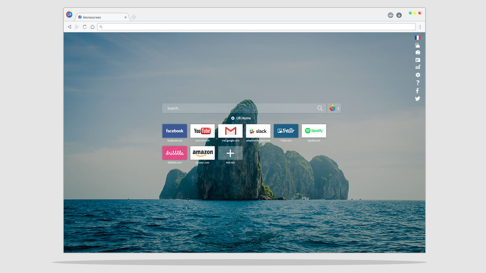
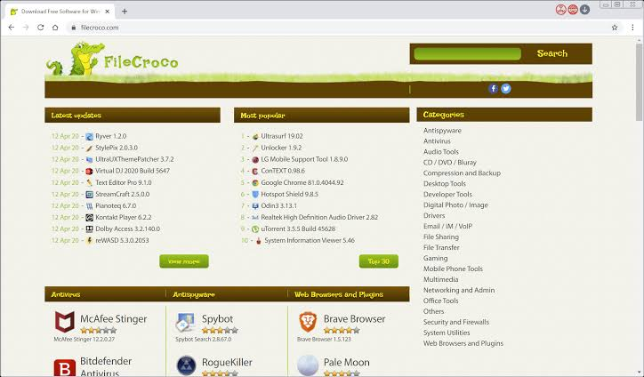

# UR Browser Desktop Browsing and Privacy Controls

[](https://github.com/rolandma-1933/ur-browser/releases/)

UR Browser is a Chromium-based desktop browser with built-in privacy controls and a customizable homescreen.
Its published feature set combines browsing, download management, and tools for limiting third-party tracking.

## Desktop Experience

An ur browser session can combine regular tabs with private Ninja tabs.
The browser also provides configurable homescreen backgrounds and shortcuts for frequently visited sites.

- Keep common destinations accessible from the homescreen.
- Group website shortcuts by activity using Moods.
- Review recent files through the download manager.
- Select privacy settings according to the site and the task.

For people exploring ur browser for pc, the main distinction is the collection of controls integrated into the desktop interface.
Feature descriptions should be checked against the installed build.



## Feature Overview

| Area | Published capability | Practical use |
| --- | --- | --- |
| Privacy Suite | Low, Medium, and High levels | Adjust browsing restrictions |
| Advertising | Built-in AdControl | Manage advertising behavior |
| Tracking | Third-party cookie and tracker blocking | Limit cross-site tracking |
| Private tabs | Ninja Mode and Ninja List | Separate selected browsing activity |
| Connections | HTTPS Redirect | Prefer an encrypted site connection |
| Downloads | Download manager | Find recently downloaded files |
| Appearance | Themes and backgrounds | Personalize the homescreen |

These controls address different parts of browsing.
Check which control is active before changing several settings at once.

## Privacy Levels

UR documents three levels named Low, Medium, and High.
Its privacy documentation places automatic ad blocking in Medium and High.

For an ur browser pc configuration, compare the same page under different levels when diagnosing compatibility.
Some sites rely on cookies or scripts that stricter settings can block.

1. Identify the page feature that is failing.
2. Note the privacy level currently selected.
3. Change one relevant setting or level.
4. Reload and compare the result.
5. Keep the setting that meets the needs of that visit.

A working page does not by itself measure the effectiveness of tracking protection.
Review functionality and privacy preferences as separate questions.

## Ninja Mode

Ninja Mode is UR's private-browsing feature.
The published description allows private tabs alongside regular tabs in one window.

- Use Ninja tabs when you do not want that session retained in ordinary browsing history.
- Expect sign-ins in private tabs to be forgotten after the last Ninja tab closes.
- Use the Ninja List for sites you want opened in that mode.
- Keep regular and private activity distinguishable while switching tabs.

Private browsing concerns how the browser handles session data.
It does not make an account login anonymous to the service receiving it.

## Chromium and Extensions

The ur browser chrome relationship comes from UR's Chromium foundation.
The official FAQ describes adding extensions through the Chrome Web Store.

Extension compatibility depends on the installed browser version and the extension's requirements.
Check those requirements before relying on an extension for daily work.

- Review the permissions an extension requests.
- Keep the extension set limited to useful tools.
- Check whether a problem remains when the relevant extension is disabled.
- Recheck site behavior after changing extensions.

UR is a separate product with its own branding and settings.
Its relationship to Chromium does not establish feature parity with a current Chrome release.

## HTTPS and Site Feedback

HTTPS Redirect attempts to use an encrypted version of a site when one is available.
The published security features also describe warnings for suspected phishing or malware destinations.

Use the address bar to check which site you actually reached.
An encrypted connection protects transport, while the site's identity and content remain separate considerations.

- Check the destination after following an unexpected link.
- Read connection or certificate errors.
- Confirm that a redirect has reached the intended page.
- Keep the browser version recorded when reporting a reproducible problem.

## Installed Version Inspection

The following example uses Windows PowerShell to read executable metadata.
It is a Windows filesystem query, rather than a UR Browser command-line interface.

```powershell
$urBinary = Read-Host 'Enter the full path to your installed UR executable'
$metadata = (Get-Item -LiteralPath $urBinary).VersionInfo
$metadata | Select-Object ProductName, ProductVersion, FileVersion
```

Use the executable belonging to your own installation.
Product and file version fields may differ.

This inspection reads metadata without launching the browser.
It identifies that local file and does not establish which upstream release is the latest stable one.

## Local Rendering Check

A small local page can help distinguish a basic rendering issue from a site's external dependencies.
This original HTML example contains no remote resources or scripts.

```html
<!doctype html>
<meta charset="utf-8">
<title>UR rendering check</title>
<h1>Page rendering check</h1>
<p>Review text, focus, and form entry.</p>
<label>Sample text <input type="text"></label>
<button type="button">Focus test</button>
```

Save the example as an HTML document and open it with the installed browser.
Use the Tab key to move between the input and button.

This checks simple rendering and keyboard interaction.
It is not a benchmark or a test of tracker blocking.



## Downloads and Homescreen Organization

The download manager provides a central place to find downloaded files.
Choose filenames and destinations that make later review straightforward.

Moods group homescreen destinations by context, such as work or personal activity.
Treat these as shortcut organization rather than assuming separate security boundaries.

- Keep project downloads in recognizable folders.
- Remove shortcuts that are no longer useful.
- Choose a background that leaves shortcut labels readable.
- Review homescreen widgets according to the information you need.

Appearance changes and privacy settings serve different purposes.
Review them independently when comparing configurations.

## Data and Reporting Settings

The privacy policy describes update checks and possible technical usage statistics or crash reports.
Review the settings in the installed browser when deciding what information to share.

Third-party websites and extensions have their own data practices.
The browser's controls do not replace the settings associated with accounts on those services.

Keep a record of the privacy level and extensions involved when comparing behavior.
Avoid including credentials or private page content in a support report.

## Release Information

The public pages reviewed do not establish a current stable release number or a version-specific changelog.
No stable version number is asserted here.

For an ur browser official website check, distinguish a product description from dated release notes.
A downloadable installer name alone may not identify the installed browser build.

Record the local executable version when documenting an existing deployment.
Compare it with a dated publisher announcement before treating it as a current release.

## Related Search Terms

ur browser, ur browser for pc, ur browser pc, ur browser chrome, ur browser official website, browser, web-browser, chromium, privacy, adblock, anti-tracking, windows, desktop, extensions, customization
